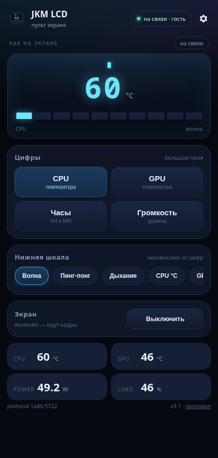

# JKM LCD — пульт экрана кулера




[English](README_EN.md) · [Deutsch](README_DE.md) · [Español](README_ES.md) · [Français](README_FR.md) · [中文](README_ZH.md) · [日本語](README_JA.md) · [한국어](README_KO.md) · [Português](README_PT.md) · [Italiano](README_IT.md)

Лёгкий пульт для сегментного LCD кулера JKM (USB `1a86:5722`, CDC-ACM, 9600 8N1):
сервер на Python (только стандартная библиотека), веб-пульт (PWA), нативное
Android-приложение «Кулер» и CLI `jkmctl`.

## Возможности

- **Цифры:** температура CPU, температура GPU, часы (ЧЧ/ММ по 2 с), громкость.
- **Нижняя шкала (независимо от цифр):** волна-змейка слева направо, пинг-понг
  (обратный ход), дыхание всей панели, полоска температуры CPU, полоска
  температуры GPU (обе 20–90 °C, мигание с 80 °C), полоска громкости,
  эквалайзер (уровень звука с выхода компьютера), пусто.
- **Верхние вкладки:** левая = часы, правая = минуты, центральная =
  температура/громкость. Управляются через `flags` и `tempType` кадра.
- **Питание:** выключение закрывает порт (индикация гаснет по таймауту прошивки),
  включение делает handshake заново.
- **Сопряжение:** 4-значный код или QR вместо копирования токена; устройство
  получает свой токен один раз и хранит его в настройках.
- **CLI:** `jkmctl` — статус, режимы, анимации, питание, сопряжение, диагностика.

## Быстрый старт

```bash
git clone https://github.com/lilwondermelo/jkm-lcd.git
cd jkm-lcd
sudo cp systemd/jkm-lcd.service /etc/systemd/system/
sudo systemctl daemon-reload && sudo systemctl enable --now jkm-lcd
curl http://<HOST>:8090/api/status
```

Открой `http://<_host_сервера_в_LAN>:8090`. С телефона — тот же адрес (PWA) или
приложение «Кулер» из «Склада».

Зависимости: Linux, Python 3.10+, `pactl`/`parec` (PipeWire/PulseAudio) для
эквалайзера и громкости; для RAPL — root. Остальное — стандартная библиотека.

Готовый APK «Кулер»: [com.arch.kuler_20.apk](apk/com.arch.kuler_20.apk) (подпись release-ключом, `versionCode 20`).

Релиз GitHub: https://github.com/lilwondermelo/jkm-lcd/releases/tag/v3.0.1 (APK также в ассетах).

> VID/PID `1a86:5722` и скорость `9600 8N1` — параметры конкретной модели индикатора, а не универсальные. У другого устройства они могут отличаться: посмотрите `lsusb` и документацию производителя. CDC-ACM — просто способ, которым операционная система видит USB-порт как последовательный (COM-порт). Адрес и порт везде ниже — переменные `<HOST>` и `<PORT>`; значения по умолчанию выбираете вы сами.

## CLI

```bash
./bin/jkmctl status              # всё состояние
./bin/jkmctl mode CPU|GPU|Часы|Громкость
./bin/jkmctl anim волна|cpu|gpu|volume|eq|пусто
./bin/jkmctl on | off            # экран
./bin/jkmctl pair                # код + QR для телефона
./bin/jkmctl devices             # привязанные устройства
./bin/jkmctl require-token on    # включить обязательный токен
./bin/jkmctl doctor               # диагностика
```

Настройки CLI — `~/.config/jkm-lcd/config.json` (600): `host`, `port`, `token`.
Настройки сервера — `~/.config/jkm-lcd/server.json` (600), состояние сопряжения —
`~/.local/state/jkm-lcd/pair.json` (600). Секреты никогда не попадают в репозиторий.

## Сопряжение телефона

1. На сервере: `jkmctl pair` — появится 4-значный код и QR-картинка (нужен `qrencode`).
2. В PWA/приложении: кнопка «привязать», ввести код.
3. Телефон единожды получает device-token и затем шлёт его в заголовке
   `X-JKM-Token`. Токен можно отозвать: `jkmctl revoke <префикс>`.

До включения `require-token` API открыт в LAN; после включения локальные
запросы (127.0.0.1) работают без токена, удалённые — только с токеном.

## HTTP API

| Метод | Путь | Тело | Назначение |
|---|---|---|---|
| GET | `/api/status` | — | режимы, анимации, датчики, звук, вкладка |
| GET | `/api/sensors` | — | только датчики |
| POST | `/api/mode` | `{"mode":"volume"}` | цифровое поле |
| POST | `/api/animation` | `{"animation":"eq"}` | нижняя шкала |
| POST | `/api/display` | `{"on":false}` | погасить/включить экран |
| GET | `/api/pair/code` | — | код + ссылка (5 минут) |
| POST | `/api/pair` | `{"code":"1234","label":"..."}` | получить device-token |
| GET | `/api/pair/devices` | — | список устройств |
| POST | `/api/pair/revoke` | `{"token":"..."}` | отозвать |
| POST | `/api/raw` | `{"hex":"…","seconds":3}` | диагностика кадров |

## Протокол и железо

Кадр 13 байт: `temp, load%, flags, RPM(2), MHz(2), W(2), GPU temp, 0, tempType, 0`.
`flags 0x40/0x80` — правая/левая вкладка, `tempType != 0` — центральная.
Шкала заполняется только слева направо (зашито в прошивке), поэтому
«обратный ход» реализован как гашение справа налево (пинг-понг).

Подробности: [docs/PROTOCOL.md](docs/PROTOCOL.md), [docs/CLI.md](docs/CLI.md),
[docs/INSTALL.md](docs/INSTALL.md), [docs/RELEASE.md](docs/RELEASE.md),
[docs/SECURITY.md](docs/SECURITY.md), [docs/GITHUB.md](docs/GITHUB.md).

## Продакшн-готовность

- Сервис systemd работает от root только ради RAPL; остальное — пользовательские
  файлы. Для других дистрибутивов пути в юните нужно поправить.
- Яркость прошивка не поддерживает; гашение — через нулевой кадр/закрытие порта.
- Все секреты — в файлах с правами 600; в репозитории их нет.
- APK подписан постоянным release-ключом; версия растёт (`versionCode`).

## Пакеты

- Arch (AUR): [packaging/arch/PKGBUILD](packaging/arch/PKGBUILD).
- Остальные дистрибутивы: npm-пакет **[@lilwondermelo/jkm-lcd](https://www.npmjs.com/package/@lilwondermelo/jkm-lcd)** (`npm i -g @lilwondermelo/jkm-lcd`).

Лицензия: MIT. Проект не связан с производителем кулера.
