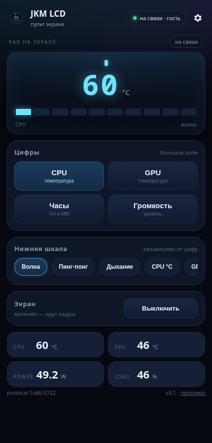

# JKM LCD — télécommande de l'écran du ventilateur




[Русский](README.md) · [English](README_EN.md) · [Deutsch](README_DE.md) · [Español](README_ES.md) · 中文 · 日本語 · 한국어 · Português · Italiano

Petit contrôleur pour l'écran LCD à segments JKM (USB 1a86:5722, CDC-ACM, 9600 8N1) :
serveur Python (bibliothèque standard), PWA, application Android native «Kuler» et CLI `jkmctl`.

## Fonctions
- Chiffres : température CPU, température GPU, horloge (HH/MM toutes les 2 s), volume.
- Barre inférieure (indépendante des chiffres) : vague, ping-pong, respiration,
  barre CPU, barre GPU (20–90 °C, clignotement dès 80 °C), barre de volume,
  égaliseur (niveau audio), vide.
- Voyants supérieurs : gauche = heures, droite = minutes, centre = température/volume.
- Éteindre ferme le port série ; allumer refait un handshake.
- Appairage : code à 4 chiffres ou QR ; le téléphone reçoit un jeton une seule fois.

## Démarrage rapide
```bash
git clone https://github.com/lilwondermelo/jkm-lcd.git
cd jkm-lcd
sudo cp systemd/jkm-lcd.service /etc/systemd/system/
sudo systemctl daemon-reload && sudo systemctl enable --now jkm-lcd
curl http://<HOST>:8090/api/status
```
Ouvrez `http://<IP-du-cube>:8090`. Nécessite Linux, Python 3.10+ et
`pactl`/`parec` pour l'audio ; RAPL demande root.

Готовый APK «Кулер»: [com.arch.kuler_22.apk](apk/com.arch.kuler_22.apk) (подпись release-ключом, `versionCode 22`).

Релиз GitHub: https://github.com/lilwondermelo/jkm-lcd/releases/tag/v3.2.0 (APK также в ассетах).

> Note: VID/PID `1a86:5722` and `9600 8N1` are for one particular display model, not universal. Check `lsusb` and your device docs. CDC-ACM just means the USB port appears as a serial (COM) port. Replace `<HOST>` and `<PORT>` with your own values.

## CLI
`jkmctl status | mode CPU|GPU|clock|volume | anim wave|cpu|gpu|volume|eq | on | off | pair | devices | doctor`
Configuration : `~/.config/jkm-lcd/config.json` (600).

## Appairage
Lancez `jkmctl pair` sur le cube, saisissez le code à 4 chiffres dans l'appli.
Révoquez avec `jkmctl revoke <préfixe>` ; rendez obligatoire avec `jkmctl require-token on`.

## API
`/api/status`, `/api/sensors`, `/api/mode`, `/api/animation`, `/api/display`,
`/api/pair/code`, `/api/pair`, `/api/pair/devices`, `/api/pair/revoke`, `/api/raw`.
Docs : [docs/PROTOCOL.md](docs/PROTOCOL.md), [docs/CLI.md](docs/CLI.md).

## Paquets
Arch : AUR [PKGBUILD](packaging/arch/PKGBUILD). Autres distros : [paquet npm](packaging/npm).
Licence MIT. Non affilié au fabricant.
