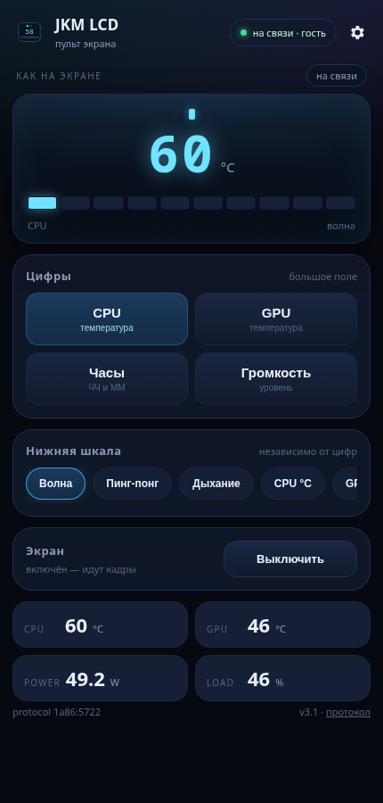

# JKM LCD — controle do display do cooler




[Русский](README.md) · [English](README_EN.md) · [Deutsch](README_DE.md) · [Español](README_ES.md) · [Français](README_FR.md) · [中文](README_ZH.md) · [日本語](README_JA.md) · [한국어](README_KO.md) · Italiano

Controle leve para o LCD de segmentos JKM (USB 1a86:5722, CDC-ACM, 9600 8N1):
servidor em Python (biblioteca padrão), PWA, app Android nativo «Kuler» e CLI `jkmctl`.

## Recursos
- Dígitos: temperatura CPU, temperatura GPU, relógio (HH/MM a cada 2 s), volume.
- Barra inferior (independente dos dígitos): onda, ping-pong, respiração,
  barra CPU, barra GPU (20–90 °C, pisca a partir de 80 °C), barra de volume,
  equalizador (nível de áudio), vazio.
- Indicadores superiores: esquerda = horas, direita = minutos, centro = temperatura/volume.
- Desligar fecha a porta serial; ligar faz novo handshake.
- Pareamento: código de 4 dígitos ou QR; o telemóvel recebe um token uma vez.

## Início rápido
```bash
git clone https://github.com/lilwondermelo/jkm-lcd.git
cd jkm-lcd
sudo cp systemd/jkm-lcd.service /etc/systemd/system/
sudo systemctl daemon-reload && sudo systemctl enable --now jkm-lcd
curl http://<HOST>:8090/api/status
```
Abra `http://<IP-do-servidor>:8090`. Requer Linux, Python 3.10+ e
`pactl`/`parec` para áudio; RAPL requer root.

Готовый APK «Кулер»: [com.arch.kuler_22.apk](apk/com.arch.kuler_22.apk) (подпись release-ключом, `versionCode 22`).

Релиз GitHub: https://github.com/lilwondermelo/jkm-lcd/releases/tag/v3.2.0 (APK также в ассетах).

> Note: VID/PID `1a86:5722` and `9600 8N1` are for one particular display model, not universal. Check `lsusb` and your device docs. CDC-ACM just means the USB port appears as a serial (COM) port. Replace `<HOST>` and `<PORT>` with your own values.

## CLI
`jkmctl status | mode CPU|GPU|clock|volume | anim wave|cpu|gpu|volume|eq | on | off | pair | devices | doctor`
Configuração: `~/.config/jkm-lcd/config.json` (600).

## Pareamento
Execute `jkmctl pair` no servidor e introduza o código de 4 dígitos no app.
Revogue com `jkmctl revoke <prefixo>`; torne obrigatório com `jkmctl require-token on`.

## API
`/api/status`, `/api/sensors`, `/api/mode`, `/api/animation`, `/api/display`,
`/api/pair/code`, `/api/pair`, `/api/pair/devices`, `/api/pair/revoke`, `/api/raw`.
Docs: [docs/PROTOCOL.md](docs/PROTOCOL.md), [docs/CLI.md](docs/CLI.md).

## Pacotes
Arch: AUR [PKGBUILD](packaging/arch/PKGBUILD). Outras distros: [pacote npm](packaging/npm).
Uso pessoal.
